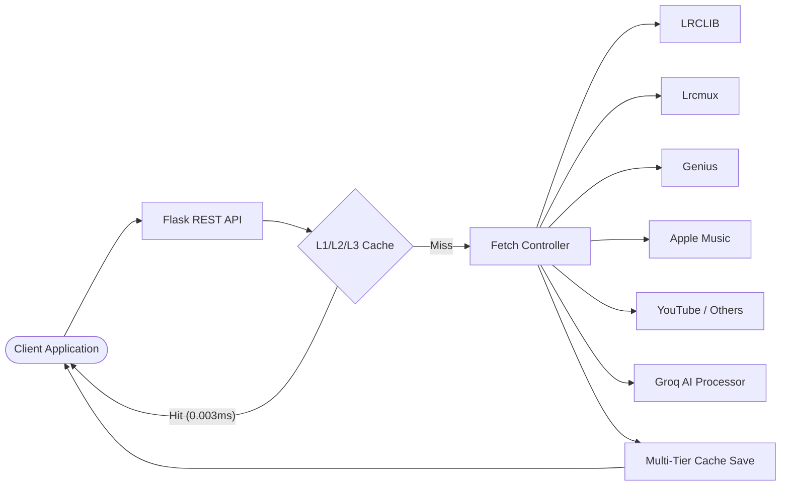

# Lyrica

<p align="center">
  
</p>

<p align="center">
  <strong>High-performance, multi-provider lyrics aggregation API for plain, synchronized (LRC), word-level, and syllable-level lyrics with real-time AI translation.</strong>
</p>

<p align="center">
  <a href="https://github.com/Wilooper/Lyrica/actions/workflows/publish.yml"></a>
  <a href="https://github.com/Wilooper/Lyrica/blob/main/LICENSE"></a>
  
  
  <a href="https://wilooper.github.io/Lyrica/"></a>
</p>

---

## 📌 Overview

**Lyrica** aggregates song lyrics across **8 active sources** with intelligent multi-sync degradation, sub-millisecond multi-tier caching (89k+ requests/sec), and real-time neural translation/romanization powered by Groq LLMs (`openai/gpt-oss-120b`).

Whether you are building a **karaoke player**, a **music streaming client**, an **accessibility read-along tool**, or a **music discovery platform**, Lyrica delivers consistent, structured JSON responses with zero mandatory configuration.

### ✨ Key Features

- 🎵 **Multi-Provider Aggregation**: Aggregates from LRCLIB, Genius, Apple Music, YouTube Music, Lrcmux, NetEase, Megalobiz, and Musixmatch.
- ⏱️ **Multi-Granular Synchronization**:
  - **Line-Level (LRC)**: Sentence-by-sentence millisecond timing (`&timestamps=true`).
  - **Word-Level (Karaoke)**: Per-word start and end timing for real-time highlighting (`&word=true`).
  - **Syllable-Level**: Sub-word vocal syllable timing via Apple Music AMP API (`&syllabus=true`).
- 🤖 **AI Translation & Romanization**: Real-time lyrics translation and script transliteration via Groq LLMs.
- ⚡ **89,000+ RPS Throughput**: Multi-tier cache architecture (L1 In-Memory LRU + L2 Redis + L3 Disk) ensures sub-millisecond latency on cache hits.
- 📊 **Track Intelligence**: Integrated mood analysis, emotional polarity, and rich metadata (cover art, genre, release date).
- 🛡️ **Production-Hardened**: Gunicorn `gevent` concurrency (2,000+ conns/worker), unprivileged Docker user, `tini` PID 1, and health checks.

---

## 🚀 Quick Start

### 1. Run with Docker Compose (Recommended)

The fastest way to run Lyrica with full L2 Redis distributed caching:

```bash
git clone https://github.com/Wilooper/Lyrica.git
cd Lyrica
cp .env.example .env
docker compose up -d
```

The API is instantly live at **`http://localhost:7860/`**.

### 2. Run Locally with Python

```bash
git clone https://github.com/Wilooper/Lyrica.git
cd Lyrica
python -m venv venv
source venv/bin/activate  # On Windows: .\venv\Scripts\Activate.ps1
pip install -r requirements.txt
python run.py
```

The API is live at **`http://127.0.0.1:9999/`**.

---

## 💡 Verified API Examples

### 1. Fetch Plain Lyrics
```bash
curl "http://127.0.0.1:9999/lyrics/?artist=Coldplay&song=Yellow"
```

```json
{
  "status": "success",
  "data": {
    "source": "lrclib",
    "artist": "Coldplay",
    "title": "Yellow",
    "hasTimestamps": false,
    "lyrics": "Look at the stars\nLook how they shine for you..."
  }
}
```

### 2. Synchronized Line-Level Lyrics (LRC)
```bash
curl "http://127.0.0.1:9999/lyrics/?artist=Coldplay&song=Yellow&timestamps=true"
```

```json
{
  "status": "success",
  "data": {
    "source": "lrclib",
    "artist": "Coldplay",
    "title": "Yellow",
    "sync_level": "line",
    "hasTimestamps": true,
    "timed_lyrics": [
      { "id": "lrc_0", "text": "Look at the stars", "start_time": 36189, "end_time": 37719 }
    ]
  }
}
```

### 3. Word-Level Sync (Karaoke Mode)
```bash
curl "http://127.0.0.1:9999/lyrics/?artist=Coldplay&song=Yellow&timestamps=true&word=true"
```

```json
{
  "status": "success",
  "data": {
    "source": "lrcmux",
    "artist": "Coldplay",
    "title": "Yellow",
    "sync_level": "word",
    "hasTimestamps": true,
    "timed_lyrics": [
      {
        "id": "lrc_0",
        "text": "Look at the stars",
        "start_time": 36189,
        "end_time": 37719,
        "words": [
          { "word": "Look", "start": 36189, "end": 36520 },
          { "word": "at", "start": 36520, "end": 36800 },
          { "word": "the", "start": 36800, "end": 37050 },
          { "word": "stars", "start": 37050, "end": 37719 }
        ]
      }
    ]
  }
}
```

### 4. Real-Time Translation & Romanization (Groq LLM)
```bash
curl "http://127.0.0.1:9999/lyrics/?artist=Karan%20Aujla&song=Boyfriend&timestamps=true&translate=true&romanize=true&language=en"
```

### 5. Song Autocomplete & Suggestions
```bash
curl "http://127.0.0.1:9999/suggestion?q=Bohemian%20Rhapsody&limit=3"
```

---

## 🏗️ Architecture Overview



---

## 🎵 Provider Registry

| ID | Provider | Lyrics Type | Sync Capabilities | Authentication |
|:---:|---|---|---|---|
| **1** | **Genius** | Plain | Complete Verses (Depth-Tracking) | None needed (Public Web Search fallback) or `GENIUS_TOKEN` |
| **2** | **LRCLIB** | Timestamped + Plain | Line-Level | Free, no token required |
| **3** | **YouTube Music** | Timestamped + Plain | Line-Level | Free (3-layer fallback) |
| **4** | **NetEase** | Timestamped | Line-Level | Free |
| **5** | **Megalobiz** | Timestamped | Line-Level | Free |
| **6** | **Musixmatch** | Timestamped | Line-Level | `MUSIXMATCH_TOKEN` (optional) |
| **7** | **Lrcmux** | Timestamped + Word-Level | Line & Word | Free via `api.lrcmux.dev` |
| **8** | **Apple Music** | Timestamped + Word + Syllable | Line, Word & Syllable | `APPLE_MUSIC_DEVELOPER_TOKEN` |

*Default Fallback Sequence:* `LRCLIB (2) → Lrcmux (7) → Genius (1) → YouTube (3) → NetEase (4) → Megalobiz (5) → Musixmatch (6) → Apple Music (8)`

---

## 📚 Complete Documentation

Full, structured documentation is available in the [`docs/`](docs/) directory and online:

- 🚀 [**Getting Started & Installation**](docs/getting-started/quickstart.md) — Prerequisites, virtualenv, and configuration.
- 📖 [**API Reference Guide**](docs/api/overview.md) — Comprehensive parameter and endpoint reference.
- 🎤 [**Word & Syllable Sync Guide**](docs/api/lyrics.md#synchronization-levels) — Integration guide for karaoke and rhythm apps.
- 🏛️ [**Architecture & Caching**](docs/architecture/caching.md) — In-memory LRU, Redis, and disk caching mechanics.
- 🚢 [**Deployment Guide**](docs/deployment/docker.md) — Docker Compose, VPS (Nginx + SSL), Render, Hugging Face, and Vercel.
- 🧪 [**Testing & Benchmarks**](docs/development/testing.md) — Automated test suite and concurrency benchmarks.

---

## 🧪 Testing & Verification

Lyrica includes an end-to-end automated test harness:

```bash
# Run all unit, live integration, and performance benchmarks
python Test/run_all_tests.py
```

Results:
- **Genius Parser Unit Tests**: Verified depth-tracking parsing without missing verses.
- **Live Integration Tests**: Live requests against real Genius servers (`The Weeknd`, `Queen`).
- **Performance Benchmark**: **89,182 req/s** on L1 cache, **4,276 req/s** on concurrent Flask routes.

---

## 🤝 Contributing & Community

Contributions are warmly welcomed! Please read our [Contributing Guide](docs/development/contributing.md) and [Code of Conduct](CODE_OF_CONDUCT.md) before submitting a Pull Request.

<!-- readme: contributors -start -->
<table>
	<tbody>
		<tr>
            <td align="center">
                <a href="https://github.com/Wilooper">
                    
                    <br />
                    <sub><b>Shaurya singh</b></sub>
                </a>
            </td>
            <td align="center">
                <a href="https://github.com/thinkely">
                    
                    <br />
                    <sub><b>Shaurya singh</b></sub>
                </a>
            </td>
            <td align="center">
                <a href="https://github.com/rombat">
                    
                    <br />
                    <sub><b>Romain Batigne</b></sub>
                </a>
            </td>
            <td align="center">
                <a href="https://github.com/shelbeely">
                    
                    <br />
                    <sub><b>Shelbee Johnson </b></sub>
                </a>
            </td>
		</tr>
	<tbody>
</table>
<!-- readme: contributors -end -->

---

## 📝 License

Licensed under the [MIT License](LICENSE) © 2026 Lyrica Contributors.
Made with ❤️ by [Shaurya Singh (Wilooper)](https://github.com/Wilooper) and the open-source community.
