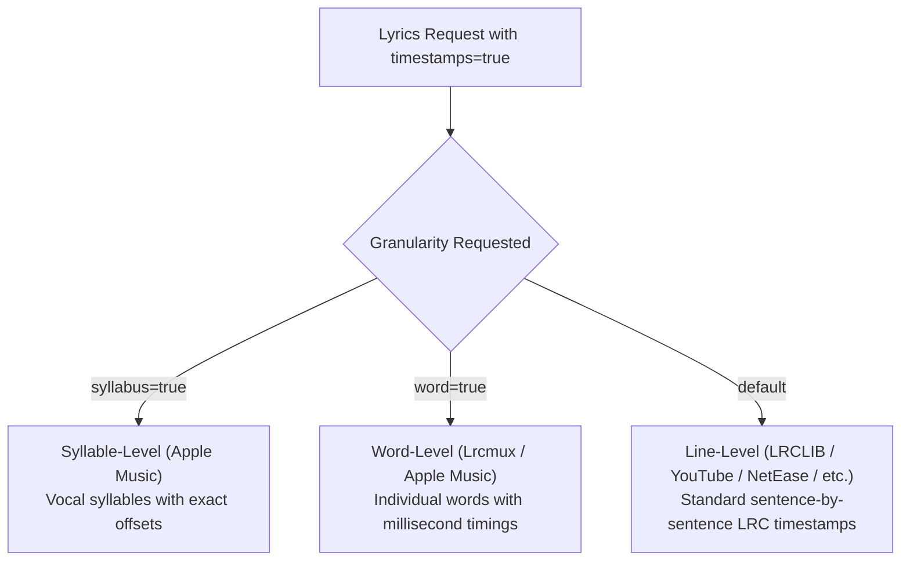

# Lyrics API (`/lyrics/`)

The primary lyrics aggregation endpoint. Queries configured providers sequentially or in parallel, resolves timing at line, word, or syllable level, and can enrich responses with mood analytics, metadata, or LLM-powered translation.

```http
GET /lyrics/
```

---

## Query Parameters

| Parameter | Type | Required | Default | Description |
|---|:---:|:---:|:---:|---|
| `artist` | string | **Yes** | — | Artist or band name (e.g., `Queen`) |
| `song` | string | **Yes** | — | Song title (e.g., `Bohemian Rhapsody`) |
| `timestamps` | boolean | No | `false` | Return synchronized lyrics with start/end millisecond timestamps |
| `word` | boolean | No | `false` | Return word-level synchronized timing entries (requires `timestamps=true`) |
| `syllabus` | boolean | No | `false` | Return syllable-level timing entries via Apple Music (requires `timestamps=true` & `APPLE_MUSIC_DEVELOPER_TOKEN`) |
| `sequence` | string | No | All | Comma-separated list of source IDs or names (e.g. `2,7,1` or `lrclib,lrcmux,genius`) |
| `pass` | boolean | No | `false` | When `true`, strictly searches sources in `sequence` without falling back to others |
| `fast` | boolean | No | `false` | Fast parallel mode: queries providers concurrently and returns first valid match |
| `mood` | boolean | No | `false` | Analyzes lyrics sentiment, subjectivity, emotional tone, and word frequencies |
| `metadata` | boolean | No | `false` | Enriches result with album art, release date, genre, and duration |
| `translate` | boolean | No | `false` | Translates lyrics into target language via Groq LLM (requires `GROQ_API_KEY`) |
| `romanize` | boolean | No | `false` | Romanizes/transliterates lyrics script via Groq LLM (requires `GROQ_API_KEY`) |
| `language` | string | No | `en` | Target language code for translation or romanization (e.g. `en`, `es`, `fr`, `hindi`) |
| `country` | string | No | `US` | Storefront country code for analytics |

---

## Synchronization Levels

Lyrica supports three levels of lyrics synchronization:



### 1. Line-Level (`timestamps=true`)
Returns lines with millisecond `start_time` and `end_time`:

```json
{
  "id": "lrc_0",
  "text": "Look at the stars",
  "start_time": 36189,
  "end_time": 37719
}
```

### 2. Word-Level (`timestamps=true&word=true`)
Adds a `words` array to each line for dynamic word-by-word karaoke highlighting:

```json
{
  "id": "lrc_0",
  "text": "Look at the stars",
  "start_time": 36189,
  "end_time": 37719,
  "words": [
    { "word": "Look", "start": 36189, "end": 36520 },
    { "word": "at", "start": 36520, "end": 36800 },
    { "word": "the", "start": 36800, "end": 37050 },
    { "word": "stars", "start": 37050, "end": 37719 }
  ]
}
```

### 3. Syllable-Level (`timestamps=true&syllabus=true`)
Provides sub-word syllable timing entries via Apple Music AMP API.

---

## AI Translation & Romanization

When `translate=true` or `romanize=true` is requested, Lyrica passes the lyrics to the configured Groq LLM model (`openai/gpt-oss-120b`).

Features:
- Preserves timestamp alignments when translating timed lyrics.
- Independent translation cache tier (`lyrica:trans:*`) prevents redundant LLM calls.
- Multi-key rotation balances traffic across multiple Groq API keys automatically.

Example request:

```bash
curl "http://127.0.0.1:9999/lyrics/?artist=Karan%20Aujla&song=Boyfriend&timestamps=true&translate=true&romanize=true&language=en"
```

Response addition:

```json
{
  "status": "success",
  "data": {
    "source": "lrclib",
    "artist": "Karan Aujla",
    "title": "Boyfriend",
    "lyrics": "...",
    "translated_lyrics": "...",
    "romanized_lyrics": "..."
  }
}
```

---

## Sentiment & Mood Analysis (`mood=true`)

When `mood=true`, Lyrica parses the lyrics text and returns emotional metrics:

```json
"sentiment": {
  "polarity": 0.42,
  "subjectivity": 0.65,
  "mood": "positive",
  "word_count": 280,
  "unique_words": 140,
  "top_words": [
    { "word": "lights", "count": 14 },
    { "word": "blinded", "count": 12 }
  ]
}
```

---

## Metadata Enrichment (`metadata=true`)

Non-blocking aggregation across iTunes, MusicBrainz, Last.fm, and Wikipedia:

```json
"metadata": {
  "album": "After Hours",
  "release_date": "2020-03-20",
  "duration_ms": 200040,
  "artwork_url": "https://is1-ssl.mzstatic.com/image/thumb/...",
  "primary_genre": "R&B/Soul",
  "sources": ["iTunes", "MusicBrainz", "Last.fm", "Wikipedia"]
}
```
