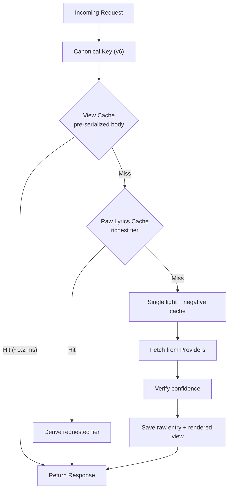

# Multi-Tier Caching Architecture

Lyrica employs a 3-tier caching system designed to minimize external provider queries, eliminate rate limiting on third-party APIs, and deliver microsecond-level response times.

---

## The 3 Cache Tiers



---

## Tier Specifications

| Tier | Technology | Latency | Storage Lifetime | Purpose |
|:---:|---|:---:|---|---|
| **L1** | In-Memory LRU Dictionary with threading locks | **~0.0003 ms** (0.3 µs) | 12 hours (production) / 1 hour (dev) | Ultra-hot items, microsecond repeat hits |
| **L2** | Redis (via `redis-py` + `hiredis` C parser) | **~0.5 ms** | Configurable via `CACHE_TTL` (default 7 days in Docker) | Shared across multiple Gunicorn workers & containers |
| **L3** | Filesystem JSON storage (`cache_data/`) | **~1.5 ms** | Persistent across process restarts | Cold fallback when Redis is absent or offline |

---

## Cache Key Formulation (`CACHE_VERSION = "v6"`)

Lyrica uses **two keys** instead of one flag-heavy key:

1. **Raw key** — canonical `(artist, title, sequence, pass)`. Flags such as
   `fast`, `mood`, `metadata`, `translate`, and the sync booleans are excluded.
   One provider fetch therefore serves every flag combination.
2. **View key** — the raw identity plus the render flags. It stores the
   fully enriched response *and* its serialized JSON body, so a hit does no
   tier derivation or JSON encoding.

```python
# Raw entry: one fetch per song, not one per flag combination
raw_key = make_lyrics_cache_key("Coldplay", "Yellow")

# Rendered view: exact response for these flags
view_key = make_view_cache_key(
    "Coldplay", "Yellow",
    timestamps=True, word_level=True, mood=False,
)
```

Normalization (`src/core/normalizer.py`) applies Unicode NFKC, case folding,
and strips edition noise (`feat.`, `(Remastered)`, `(Live)`), so
`"The  Beatles"` and `"the beatles"` share one entry.

The raw entry stores the **richest tier fetched** (`syllable > word > line >
plain`). Lower tiers are derived on demand. A plain entry can never satisfy a
timed request because timestamps cannot be invented. Upgrade attempts are
monotonic: a lower-tier result never overwrites a richer cached entry.

---

## Negative Cache and Singleflight

- A confirmed "not found" is cached for `LYRICA_NEGATIVE_TTL` seconds
  (default 1 hour). Provider errors and rejected wrong-song results are
  **never** negative-cached.
- Concurrent requests for the same raw key are coalesced in-process
  (`src/core/singleflight.py`), so a cache stampede produces exactly one
  upstream fetch. The negative cache uses Redis automatically when configured.

---

## Translation Cache

LLM inference via Groq is an expensive operation in terms of tokens and latency. Therefore, translation and romanization outputs are cached in an independent, specialized cache tier (`src/translation_cache.py`):
- Redis Namespace: `lyrica:trans:<hash>`
- Key Parameters: `artist`, `song`, `source`, `language`, `translate`, `romanize`, `has_timestamps`

---

## Cache Promotion Logic

When an item misses L1 memory but hits in L2 Redis or L3 Disk, Lyrica automatically **promotes** the item into L1 memory for subsequent requests. In production mode (`LYRICA_ENV=production`), the promotion TTL is set to 12 hours (`43200` seconds) because lyrics are immutable content.

---

## Performance Benchmark

Results measured under high-concurrency stress test (`Test/test_performance.py`) during the v2-beta-rollout release run:

- **L1 In-Memory LRU Throughput**: **68,624 requests/second**
- **Median (p50) Latency**: **0.0003 ms**
- **95th Percentile (p95) Latency**: **0.0015 ms**
- **99th Percentile (p99) Latency**: **0.0034 ms**
- **Error Rate**: 0.0%

These are local microbenchmark results, not a production HTTP capacity guarantee. See the [release notes](../release-notes/v2-beta-rollout.md) for the full in-process and live HTTP matrices.
