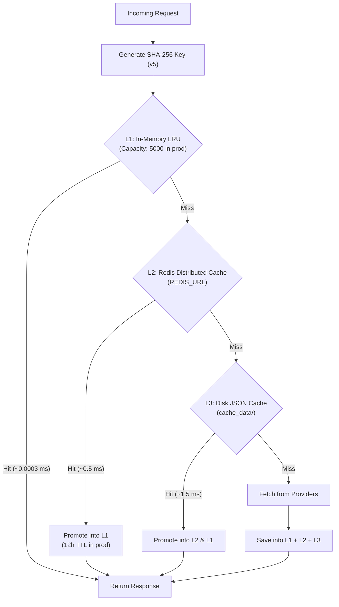

# Multi-Tier Caching Architecture

Lyrica employs a 3-tier caching system designed to minimize external provider queries, eliminate rate limiting on third-party APIs, and deliver microsecond-level response times.

---

## The 3 Cache Tiers



---

## Tier Specifications

| Tier | Technology | Latency | Storage Lifetime | Purpose |
|:---:|---|:---:|---|---|
| **L1** | In-Memory LRU Dictionary with threading locks | **~0.0003 ms** (0.3 µs) | 12 hours (production) / 1 hour (dev) | Ultra-hot items, microsecond repeat hits |
| **L2** | Redis (via `redis-py` + `hiredis` C parser) | **~0.5 ms** | Configurable via `CACHE_TTL` (default 7 days in Docker) | Shared across multiple Gunicorn workers & containers |
| **L3** | Filesystem JSON storage (`cache_data/`) | **~1.5 ms** | Persistent across process restarts | Cold fallback when Redis is absent or offline |

---

## Cache Key Formulation (`CACHE_VERSION = "v5"`)

Cache keys are deterministic **SHA-256 hashes** computed over a canonical JSON object:

```python
payload = {
    "v": "v5",
    "artist": "coldplay",
    "song": "yellow",
    "timestamps": True,
    "sequence": "",
    "fast": False,
    "mood": False,
    "metadata": False,
    "translate": False,
    "romanize": False,
    "language": "en",
    "word_level": True,
    "syllabus": False,
}
```

This guarantees:
1. **Collision Immunity**: Changing any flag (`timestamps`, `word_level`, `syllabus`, `translate`, `language`) produces a completely unique cache key.
2. **Filesystem Safety**: Hashes are hex strings, avoiding invalid directory characters across operating systems.
3. **Redis Namespace Isolation**: Keys are stored in Redis under the `lyrica:lyrics:<hash>` namespace.

---

## Translation Cache

LLM inference via Groq is an expensive operation in terms of tokens and latency. Therefore, translation and romanization outputs are cached in an independent, specialized cache tier (`src/translation_cache.py`):
- Redis Namespace: `lyrica:trans:<hash>`
- Key Parameters: `artist`, `song`, `source`, `language`, `translate`, `romanize`, `has_timestamps`

---

## Cache Promotion Logic

When an item misses L1 memory but hits in L2 Redis or L3 Disk, Lyrica automatically **promotes** the item into L1 memory for subsequent requests. In production mode (`LYRICA_ENV=production`), the promotion TTL is set to 12 hours (`43200` seconds) because lyrics are immutable content.

---

## Performance Benchmark

Results measured under high-concurrency stress test (`Test/test_performance.py`):

- **L1 In-Memory LRU Throughput**: **89,182 requests/second**
- **Median (p50) Latency**: **0.0003 ms**
- **99th Percentile (p99) Latency**: **0.0011 ms**
- **Error Rate**: 0.0%
