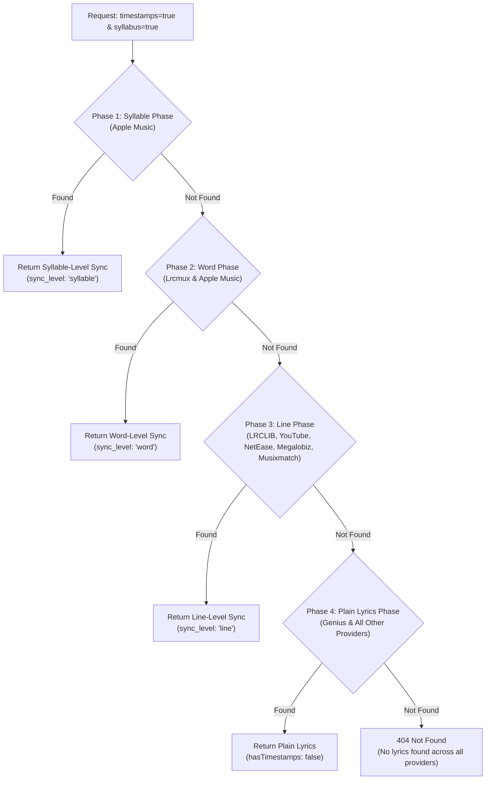

# Provider Fallback & Sync Degradation

Lyrica features an intelligent provider selection and synchronization-level degradation hierarchy. This guarantees that your application always receives the highest quality lyrics and timestamps available without failing abruptly.

---

## Multi-Sync-Level Fallback Hierarchy

When a client requests granular timing (such as syllable-level or word-level sync), not every song in every catalog will have per-word or per-syllable annotations. Rather than returning an error, Lyrica gracefully degrades down the sync ladder:



---

## Fallback Phases in Detail

### Phase 1: Syllable Phase (`&syllabus=true`)
- **Sources**: Apple Music (ID 8).
- **Condition**: Only triggers when `timestamps=true` and `syllabus=true`.
- **Degradation**: If Apple Music does not have syllable-level timing or `APPLE_MUSIC_DEVELOPER_TOKEN` is unset, automatically degrades to Phase 2.

### Phase 2: Word Phase (`&word=true`)
- **Sources**: Lrcmux (ID 7) and Apple Music (ID 8).
- **Condition**: Triggers when `timestamps=true` and `word=true`.
- **Degradation**: If no word-level timestamps are found on Lrcmux or Apple Music, degrades to Phase 3.

### Phase 3: Line Phase (`&timestamps=true`)
- **Sources**: LRCLIB (ID 2), Lrcmux (ID 7), YouTube Music (ID 3), NetEase (ID 4), Megalobiz (ID 5), Musixmatch (ID 6).
- **Condition**: Triggers when `timestamps=true`.
- **Degradation**: If no synchronized LRC lines exist anywhere, degrades to Phase 4.

### Phase 4: Plain Lyrics Phase
- **Sources**: LRCLIB, Genius (ID 1), YouTube Music, NetEase, Megalobiz, Musixmatch.
- Queries all active plain text lyrics sources.

---

## Sequential vs. Fast Parallel Mode

### Sequential Mode (Default)
Providers are queried one by one in the order specified by the `sequence` parameter (or the default sequence). Execution stops as soon as a provider returns valid lyrics that satisfy the requested sync level.

*Advantage*: Generates the minimum necessary network traffic.

### Fast Parallel Mode (`fast=true`)
When `fast=true`, the Fetch Controller launches concurrent async tasks against all candidates in parallel using `asyncio.as_completed()`. The first provider to respond with valid lyrics wins, and pending requests are cleanly cancelled.

*Advantage*: Minimizes latency by returning the fastest responding provider.

---

## Strict Mode (`pass=true`)

If you want to prevent fallback and enforce that lyrics come **only** from specific providers, set `pass=true` in conjunction with `sequence`:

```http
GET /lyrics/?artist=Queen&song=Bohemian%20Rhapsody&sequence=genius&pass=true
```

In this mode, Lyrica will only query Genius; if Genius does not have the song, it returns `404 Not Found` immediately instead of falling back to LRCLIB or others.
