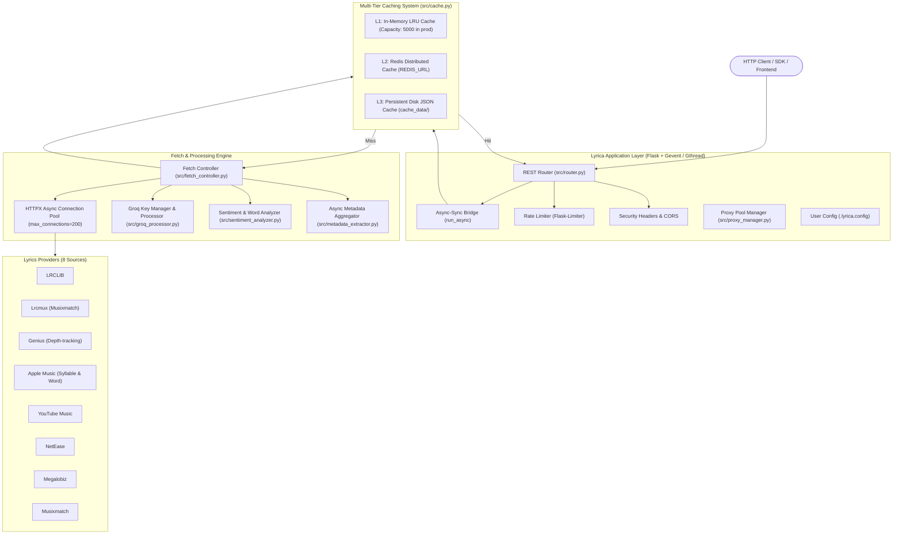
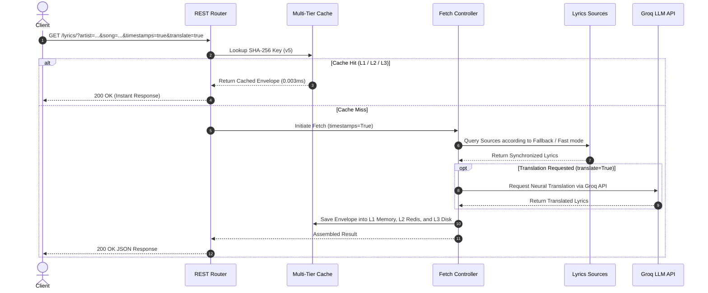

# Architecture Overview

This document provides a technical deep dive into Lyrica's system design, concurrency model, and request lifecycles.

---

## High-Level System Architecture

---

## Request Lifecycle Sequence

The following sequence illustrates what happens when a client requests synchronized, translated lyrics:

---

## Core Components

### 1. Flask App Factory (`src/app.py`)
- Initializes Flask with CORS, gzip compression via `Flask-Compress`, and Flask-Limiter.
- Detects `LYRICA_ENV=production`:
    - Enforces HSTS, CSP, `X-Frame-Options: DENY`, `X-Content-Type-Options: nosniff`.
    - Adjusts default rate limits (e.g. 60 RPM).
    - Seeds the proxy pool from `PROXY_URL`.

### 2. Async-to-Sync Bridge (`run_async()` in `src/router.py`)
Flask routes run synchronously in worker threads, while provider integrations and metadata extractors use `httpx.AsyncClient` with `asyncio.gather` for non-blocking I/O. The `run_async()` bridge manages event loops cleanly with `nest_asyncio` and timeouts.

### 3. Shared HTTP Connection Pool (`src/sources/base_fetcher.py`)
All fetchers inherit from `BaseFetcher` and utilize a centralized, thread-safe `httpx.AsyncClient` with connection pooling (`max_connections=200`, `max_keepalive_connections=50`). This prevents socket exhaustion during high concurrent request bursts.

### 4. Fetch Controller (`src/fetch_controller.py`)
Orchestrates provider execution order, handles the intelligent multi-sync degradation hierarchy (syllable → word → line → plain), and supports both sequential fallback and parallel (`fast=true`) modes.
