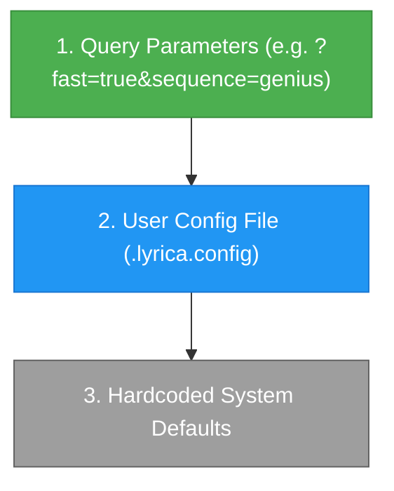

# User Configuration (`.lyrica.config`)

In addition to environment variables, Lyrica supports fine-grained application preferences through a `.lyrica.config` file in standard INI format.

---

## Configuration Hierarchy

Lyrica resolves settings using a strict 3-tier hierarchy:



1. **Query Parameters**: Explicit request parameters *always* take highest precedence.
2. **`.lyrica.config`**: Overrides system defaults for all requests where parameters are omitted.
3. **Hardcoded Defaults**: Built-in fallback behavior.

---

## Example `.lyrica.config` File

Create a file named `.lyrica.config` in your project root:

```ini
[defaults]
# Default source to query first when sequence is omitted
default_source = lrclib

# Comma-separated default source sequence
sequence = lrclib,lrcmux,genius,youtube,netease,megalobiz,musixmatch,apple_music

# Default modes when omitted from request query params
fast_mode = false
timestamps = false
word_level = false
syllabus = false
mood = false
metadata = false

# Default translation settings
translate = false
romanize = false
language = en

[cache]
# Default TTL for cache in seconds (86400 = 24 hours)
ttl = 86400

# Enable in-memory L1 cache
memory_cache = true

[sources]
# Disable specific sources entirely across the server
disable_genius = false
disable_youtube = false
disable_netease = false
disable_megalobiz = false
disable_musixmatch = false
disable_apple_music = false
```

---

## Hot-Reloading Without Restart

You can modify `.lyrica.config` on a running server and reload it immediately via the admin API:

```bash
curl -X POST "http://127.0.0.1:9999/config/reload" \
     -H "X-ADMIN-KEY: your_admin_key"
```

The server re-parses the file into memory without dropping in-flight connections.
