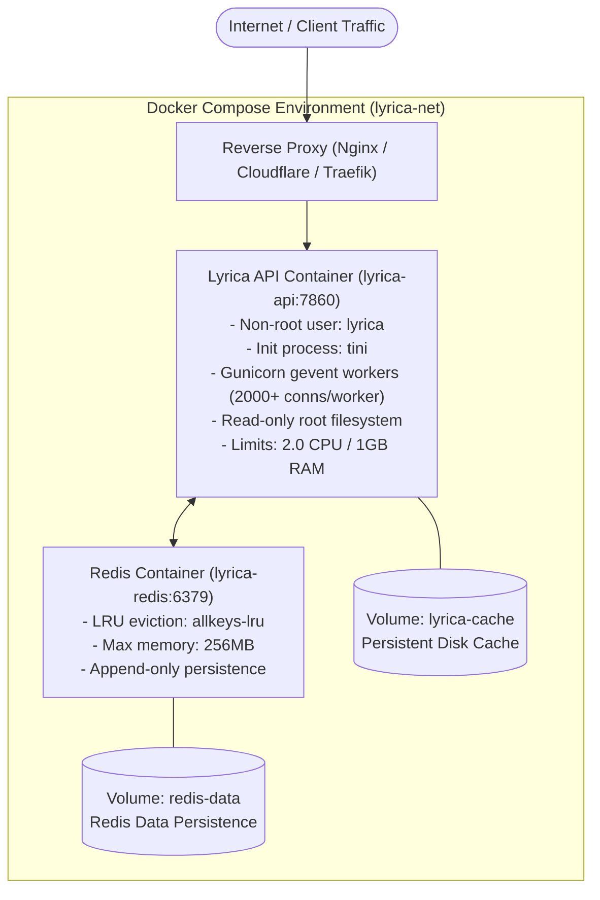

# Docker & Docker Compose Deployment

Lyrica provides a production-grade, hardened container setup optimized for high concurrency, security, and stability.

---

## Architecture Overview



---

## 1. Quickstart with Docker Compose (Recommended)

Docker Compose starts the Lyrica API along with an optimized Redis sidecar container.

### Step 1: Clone and Configure

```bash
git clone https://github.com/Wilooper/Lyrica.git
cd Lyrica
cp .env.example .env
```

Review `.env` and set your `ADMIN_KEY` and any optional tokens.

### Step 2: Start Containers

```bash
# Build and start in background
docker compose up -d
```

### Step 3: Verify and Follow Logs

```bash
# Check container status & health checks
docker compose ps

# Follow application logs
docker compose logs -f lyrica
```

The API is immediately accessible at `http://localhost:7860/`.

---

## 2. Standalone Docker Container

If you prefer to run Lyrica without Redis using local disk caching:

```bash
# Build the production image
docker build -t lyrica:1.5.0 .

# Run container
docker run -d \
  --name lyrica-api \
  -p 7860:7860 \
  --env-file .env \
  -v $(pwd)/cache_data:/app/cache_data \
  lyrica:1.5.0
```

---

## 3. Production Hardening Features

The included `Dockerfile`, `docker-compose.yml`, and `gunicorn_production.py` feature:

### Concurrency & Performance
- **Gevent Greenlets**: `gunicorn_production.py` runs with `worker_class = "gevent"`, capable of handling **2,000+ concurrent connections per worker**.
- **RAM Heartbeats**: Uses `/dev/shm` tmpfs for Gunicorn heartbeat files to eliminate disk I/O bottlenecks.
- **Worker Recycling**: Workers automatically recycle after `5,000` requests (with `±500` request jitter) to eliminate memory leaks.

### Security Hardening
- **Unprivileged User**: The container drops root privileges and runs as user `lyrica` (`UID/GID`).
- **Read-Only Root Filesystem**: `read_only: true` in Compose prevents malicious container file modifications.
- **No New Privileges**: `security_opt: ["no-new-privileges:true"]` prevents privilege escalation attacks.
- **Tini Init Process**: Uses `tini` as PID 1 to ensure POSIX signal forwarding (`SIGTERM`) and clean zombie process reaping.

### Resource Limits
- CPU: Capped at `2.0` cores (reserved `0.5`).
- Memory: Capped at `1GB` RAM (reserved `256MB`).
- Redis: Capped at `256MB` RAM with `allkeys-lru` automatic eviction.
