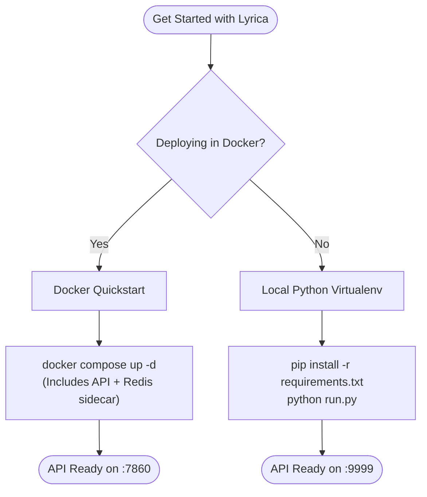

# Getting Started

Welcome to the Lyrica setup and onboarding section. Whether you are running Lyrica locally for personal projects or preparing a containerized microservice for high-throughput production workloads, this section will guide you through setup in minutes.

---

## Choosing Your Path

---

## Recommended Path

1. **New Users & Quick Evaluation**: Follow the [Quickstart Guide](quickstart.md) to make your first lyrics, translation, and sentiment requests in under 5 minutes.
2. **Developers & Self-Hosters**: Follow the [Installation Guide](installation.md) for full control over local Python dependencies, `.env` settings, and `.lyrica.config` rules.
3. **Production Deployments**: Jump straight to the [Docker & Compose Guide](../deployment/docker.md).
