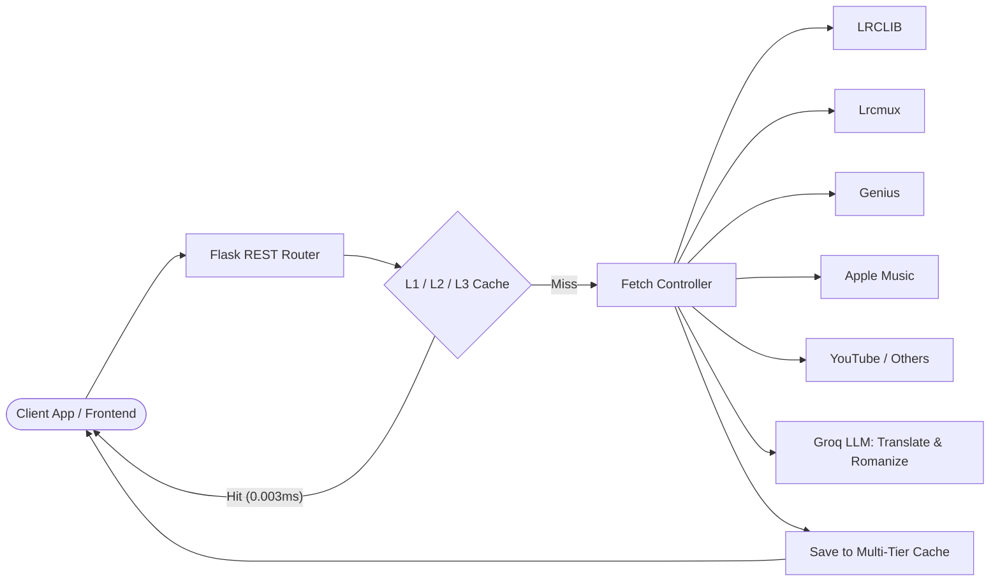

# Lyrica Documentation

<p align="center">
  <strong>A high-performance lyrics aggregation API with word-level sync, AI translation, metadata enrichment, and multi-tier caching.</strong>
</p>

---

## Welcome to Lyrica

**Lyrica** is an open-source, production-grade Python/Flask REST API (v1.5.0) that aggregates song lyrics across multiple providers (LRCLIB, Genius, YouTube Music, Lrcmux, Apple Music, NetEase, Megalobiz, and Musixmatch).

It offers multi-level synchronization (line-level LRC, word-level karaoke sync, and syllable-level timing), Groq LLM-powered lyrics translation and romanization, audio metadata extraction, real-time Apple Music trending charts, and a multi-tier cache architecture capable of handling **89,000+ requests/second**.



---

## Key Highlights

- **8 Active Providers**: Intelligent fallback across LRCLIB, Lrcmux, Genius, Apple Music, YouTube Music, NetEase, Megalobiz, and Musixmatch.
- **Granular Synchronization**:
    - **Line-level**: Standard LRC format timestamps.
    - **Word-level**: Millisecond-accurate word timing for interactive karaoke applications (`&word=true`).
    - **Syllable-level**: Sub-word syllable timing for high-fidelity vocal read-along (`&syllabus=true`).
- **Real-Time Translation**: Neural translation and Roman script transliteration via Groq LLM (`openai/gpt-oss-120b`).
- **Blazing Performance**: L1 in-memory LRU cache + L2 Redis + L3 persistent disk cache. Sub-millisecond response on cache hits.
- **Zero Required Setup**: Fully functional out of the box without mandatory third-party credentials.
- **Production Hardened**: Multi-stage Docker image, Docker Compose with Redis sidecar, Gunicorn gevent concurrency (2,000+ connections per worker), read-only rootfs, and security headers.

---

## Documentation Navigation

| Section | Description |
|---|---|
| [**Getting Started**](getting-started/quickstart.md) | 5-minute quickstart guide, installation options, and first API requests |
| [**API Reference**](api/overview.md) | Complete endpoint catalog, query parameters, schemas, and error responses |
| [**Architecture**](architecture/overview.md) | Technical deep-dive into request lifecycles, caching tiers, and fallback logic |
| [**Providers**](providers/overview.md) | Details on supported lyrics sources, rate limits, and configuration |
| [**Configuration**](configuration/environment.md) | Guide to environment variables (`.env`) and user INI preferences (`.lyrica.config`) |
| [**Deployment**](deployment/docker.md) | Production deployment across Docker, Render, Hugging Face, VPS, and cloud hosts |
| [**Development**](development/testing.md) | Test suites, performance benchmarks, and contribution guidelines |
| [**Troubleshooting**](troubleshooting/faq.md) | Diagnostics, common questions, cloud IP blocks, and solutions |

---

## Quick Example

Request synchronized word-level lyrics in a single HTTP request:

```bash
curl -s "http://127.0.0.1:9999/lyrics/?artist=Coldplay&song=Yellow&timestamps=true&word=true"
```

Response snippet:

```json
{
  "status": "success",
  "data": {
    "source": "lrcmux",
    "artist": "Coldplay",
    "title": "Yellow",
    "sync_level": "word",
    "hasTimestamps": true,
    "timed_lyrics": [
      {
        "id": "lrc_0",
        "text": "Look at the stars",
        "start_time": 36189,
        "end_time": 37719,
        "words": [
          { "word": "Look", "start": 36189, "end": 36520 },
          { "word": "at", "start": 36520, "end": 36800 },
          { "word": "the", "start": 36800, "end": 37050 },
          { "word": "stars", "start": 37050, "end": 37719 }
        ]
      }
    ]
  }
}
```
