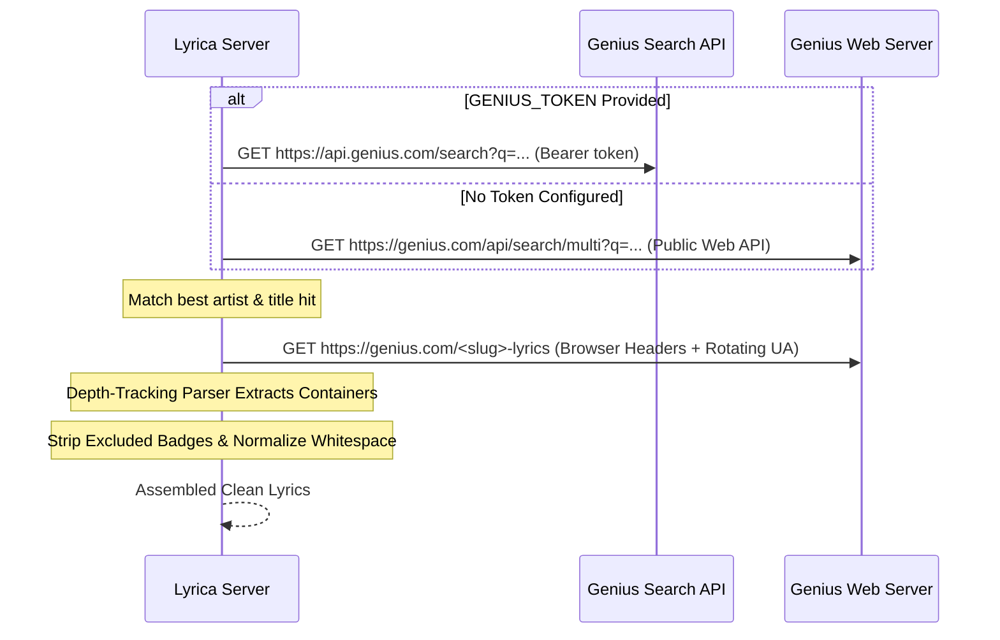

# Genius Lyrics Provider (`genius`)

Genius is the world's largest repository of song lyrics and musical knowledge. In Lyrica, the Genius integration (`src/sources/genius_fetcher.py`) provides high-fidelity plain text lyrics with section markers (`[Verse 1]`, `[Chorus]`, `[Bridge]`, etc.).

---

## Technical Architecture

The Genius API does not return full lyrics text in its JSON search endpoints; it only returns metadata including the song's canonical web page URL (`genius.com/<slug>-lyrics`). 

Lyrica resolves Genius lyrics via a 2-step process:



---

## The Depth-Tracking HTML Parser

### The Missing Verse Problem
Genius stores lyrics fragmented across multiple `<div data-lyrics-container="true">` elements. Each container contains deeply nested `<div>`, `<a>`, and `<span>` elements for user annotations, editorial notes, and advertisements.

A standard regex such as:
```python
# BROKEN — Terminates on first inner </div>
re.findall(r'<div data-lyrics-container="true">(.*?)</div>', html)
```
terminates prematurely at the first nested closing tag, truncating verses and causing incomplete lyrics.

### The Solution in Lyrica
Lyrica implements a **depth-tracking parser** (`_extract_container_contents`) that tracks opening and closing div depths linearly without requiring heavy parsing libraries like `BeautifulSoup`:

1. Identifies opening `<div data-lyrics-container="true">` tags.
2. Tracks nested `<div>` increments and `</div>` decrements until the container boundary is found.
3. Completely captures every verse, chorus, and outro container.

---

## Noise & Artifact Exclusion

Genius injects non-lyric UI artifacts into song pages. Lyrica automatically eliminates:
- **Contributor Badges**: Elements marked with `data-exclude-from-selection="true"` (e.g. `271 Contributors`, translation dropdowns).
- **Embed Counters**: Trailing `150 Embed` footers.
- **Special Unicode Spacing**: Replaces non-standard four-per-em spaces (`\u2005`), non-breaking spaces (`\xa0`), and zero-width spaces (`\u200b`, `\u200c`) with standard UTF-8 whitespace.
- **HTML Entities**: Decodes `&amp;`, `&quot;`, `&#x27;` into plain text.

---

## Configuration & Authentication

Genius works **with or without** an API key:

```ini
# Optional: Genius Client Access Token
# Register at: https://genius.com/api/clients
GENIUS_TOKEN=your_token_here
```

- **With `GENIUS_TOKEN`**: Queries the official API endpoint `https://api.genius.com/search`.
- **Without `GENIUS_TOKEN`**: Automatically falls back to the public web search endpoint `https://genius.com/api/search/multi`.

---

## Avoiding Bot Detection
Genius employs Cloudflare rate limiting on web page scraping. Lyrica mitigates blocks via:
1. **User-Agent Rotation**: Automatically cycles realistic browser User-Agent headers across Chrome, Firefox, and Safari.
2. **Global Proxy Pool**: Configure `PROXY_URL` in `.env` to route requests through residential proxies.
