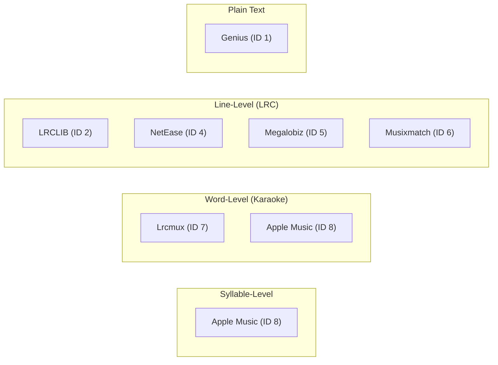

# Lyrics Providers Matrix

Lyrica aggregates lyrics from **7 available providers**: 5 zero-config sources plus 2 token-gated sources. YouTube Music is temporarily disabled while its fetcher is rebuilt. Each provider offers different synchronization capabilities, authentication requirements, and strengths.

---

## Provider Comparison Matrix

| ID | Name | Fetcher Class | Lyrics Type | Sync Level | Authentication | Reliability |
|:---:|---|---|---|---|---|:---:|
| **1** | **Genius** | `GeniusFetcher` | Plain | None | None needed (public search fallback) or `GENIUS_TOKEN` | High |
| **2** | **LRCLIB** | `LrclibFetcher` | Timestamped + Plain | Line | None (Free, open-source API) | Very High |
| **3** | **YouTube Music** | `YouTubeFetcher` | — | — | Temporarily disabled (fetcher being rebuilt) | — |
| **4** | **NetEase** | `NetEaseFetcher` | Timestamped | Line | None (via syncedlyrics) | Medium |
| **5** | **Megalobiz** | `MegalobizFetcher` | Timestamped | Line | None (via syncedlyrics) | Medium |
| **6** | **Musixmatch** | `MusixmatchFetcher` | Timestamped | Line | `MUSIXMATCH_TOKEN` required to load | High with token |
| **7** | **Lrcmux** | `LrcmuxFetcher` | Timestamped + Word | Line, Word | None (`https://api.lrcmux.dev`) | Very High |
| **8** | **Apple Music** | `AppleMusicFetcher` | Timestamped + Word + Syllable | Line, Word, Syllable | `APPLE_MUSIC_DEVELOPER_TOKEN` required to load | Very High |

---

## Default Fallback Sequence

When no `sequence` parameter is specified, Lyrica executes providers in the following default order:

```
LRCLIB (2) → Lrcmux (7) → Genius (1) → NetEase (4) → Megalobiz (5) → Musixmatch (6) → Apple Music (8)
```

Token-gated providers are omitted from the active sequence when their token is not configured. You can customize this order per request using the `sequence` query parameter (e.g., `sequence=genius,lrclib` or `sequence=1,2`).

For `word=true` or `syllabus=true`, automatic routing is restricted to **Lrcmux (7)** and **Apple Music (8)** so line-only providers are not queried. An explicit `pass=true` sequence is honored as-is.

---

## Granularity Breakdown


