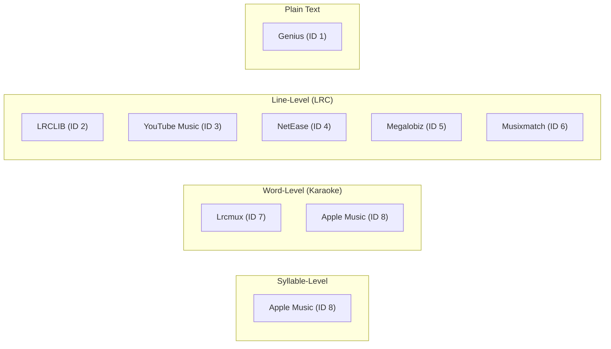

# Lyrics Providers Matrix

Lyrica aggregates lyrics from **8 active providers**, each offering different synchronization capabilities, authentication requirements, and strengths.

---

## Provider Comparison Matrix

| ID | Name | Fetcher Class | Lyrics Type | Sync Level | Authentication | Reliability |
|:---:|---|---|---|---|---|:---:|
| **1** | **Genius** | `GeniusFetcher` | Plain | None | None needed (public search fallback) or `GENIUS_TOKEN` | High |
| **2** | **LRCLIB** | `LrclibFetcher` | Timestamped + Plain | Line | None (Free, open-source API) | Very High |
| **3** | **YouTube Music** | `YouTubeFetcher` | Timestamped + Plain | Line | None (3-layer fallback: ytmusicapi, transcript-api, yt-dlp) | High |
| **4** | **NetEase** | `NetEaseFetcher` | Timestamped | Line | None (via syncedlyrics) | Medium |
| **5** | **Megalobiz** | `MegalobizFetcher` | Timestamped | Line | None (via syncedlyrics) | Medium |
| **6** | **Musixmatch** | `MusixmatchFetcher` | Timestamped | Line | `MUSIXMATCH_TOKEN` required | High with token |
| **7** | **Lrcmux** | `LrcmuxFetcher` | Timestamped + Word | Line, Word | None (`https://api.lrcmux.dev`) | Very High |
| **8** | **Apple Music** | `AppleMusicFetcher` | Timestamped + Word + Syllable | Line, Word, Syllable | `APPLE_MUSIC_DEVELOPER_TOKEN` | Very High |

---

## Default Fallback Sequence

When no `sequence` parameter is specified, Lyrica executes providers in the following default order:

```
LRCLIB (2) → Lrcmux (7) → Genius (1) → YouTube Music (3) → NetEase (4) → Megalobiz (5) → Musixmatch (6) → Apple Music (8)
```

You can customize this order per request using the `sequence` query parameter (e.g., `sequence=genius,lrclib` or `sequence=1,2`).

---

## Granularity Breakdown


